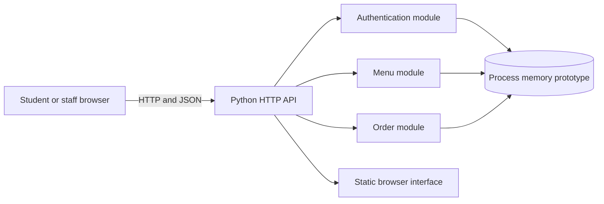
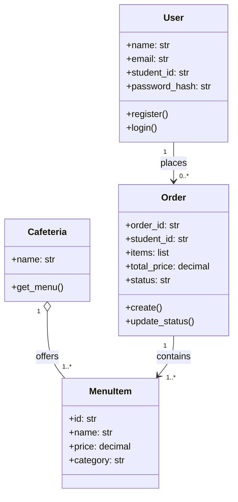
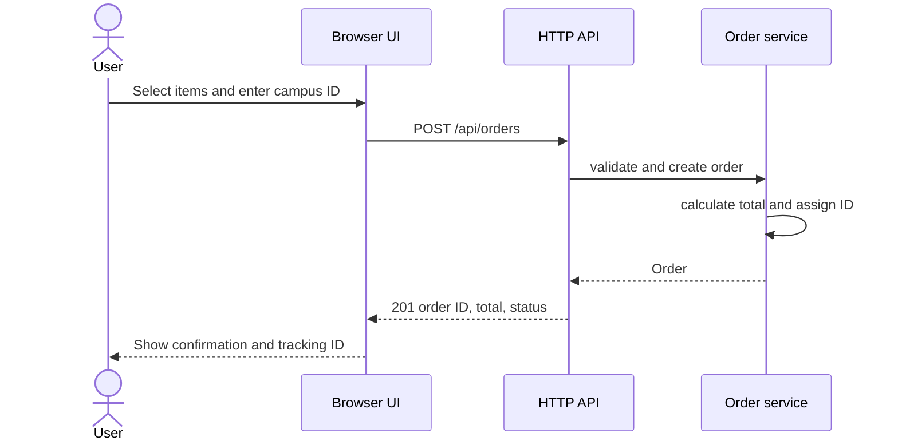
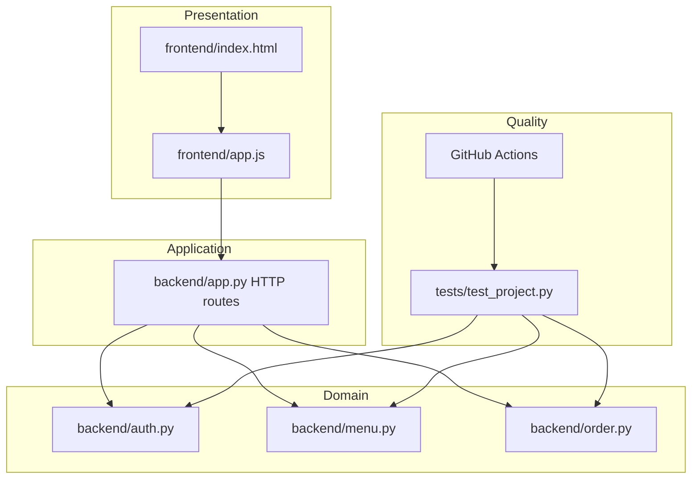

# Architecture and Design

## Pattern
The prototype uses a lightweight layered, modular monolith. The HTTP handler routes requests and serializes responses; domain modules hold authentication, menu, and order operations; the browser client renders data and gathers user input. This keeps a classroom build simple to run while retaining boundaries that can later be moved behind a framework or database.

## Module diagram

## Class diagram

## Sequence diagram for placing an order

## Component and package diagram

## Design pattern example
The application uses a small Factory Method through `Order.create(...)`: it validates input, computes totals, creates the ID, and stores the order while callers depend on the returned `Order` model. This centralizes construction rules. A later refactor could inject repositories and an event publisher rather than keep module-level memory stores.

## Security and limitations
The prototype's menu is static; order and account state is volatile. The API has no session, access control, authorization boundary, durable audit trail, or payment integration, so its demo status update endpoint is not safe for deployment. Prices must be retrieved by item ID on the server. A production design should add a database, secure identity/session handling, staff-only status updates, user-specific order authorization, payment-provider hosted checkout/tokenization, HTTPS, CSRF protection where applicable, request throttling, and audit logging. Real-time tracking would use polling or server-sent events after reliable state storage is introduced.